# keystep-mods

Mods for the Arturia KeyStep Pro: new features for its firmware, applied to your own copy of the official update.
Pick the mods you want, build a patched update in your browser, and flash it with MIDI Control Center like any
other update. Flashing the stock update puts the original firmware back.

**[Open the patcher](https://yonie.github.io/keystep-mods/)** to see the mods in action and build your update.

> [!WARNING]
> **At your own risk.** These mods are unofficial changes to the KeyStep Pro firmware, not made, checked or supported
> by Arturia. You flash them entirely at your own risk and responsibility. They come as they are, without warranty of
> any kind, and the author is not liable for any damage, data loss or malfunction of your instrument. Flashing the
> official update puts the original firmware back.

## The mods

**`generative`**: Generative tracks. Flux on Tracks 2 to 4, a melody loop that keeps changing; Pulse on Track 1,
drum pulses spread evenly over each drum lane's steps ([below](#generative-tracks-the-generative-mod)).

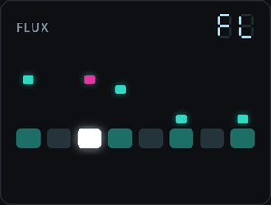 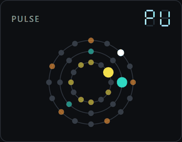

**`filter-midicc`**: Clean pattern switches. A pattern switch no longer re-sends Bank MSB, Bank LSB and Program
Change when that MIDI channel already has them, so the first note after a switch is no longer late on synths that
reload their sound on every program change ([below](#clean-pattern-switches-the-filter-midicc-mod)).

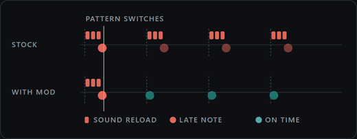

Mods combine: tick several and they go into one update. Both mods have been flashed to a real KeyStep Pro, and
Generative tracks has been played on it.

They only work on KeyStep Pro firmware **2.5.20**, on both the standard KeyStep Pro and the KeyStep Pro Chroma.
The page checks that your file is the untouched 2.5.20 update before it changes anything. If MIDI Control Center
offers a newer firmware, the mods do not apply to it.

Flashing a patched update is at your own risk. The page and the MIT licence come with no warranty.

## Building a patched update

**Get the page.** On GitHub, download this repository as a ZIP (the green Code button, then Download ZIP) and
unzip it. Double-click `web/index.html` to open it in your browser. It works offline, straight from disk.

**Find your stock update file.** MIDI Control Center installs it. On Windows it is
`C:\ProgramData\Arturia\MIDI Control Center\Firmware\keystep-pro_Firmware_Update_2.5.20.0.kspf`. On macOS it is in
MIDI Control Center's firmware folder. Keep a copy of this file somewhere safe: it is how you go back to stock.

**Build.** Drop the stock file onto the page, tick the mods, build, and save the result. Everything happens in the
browser; the firmware is not uploaded anywhere.

## Flashing it

1. Connect the KeyStep Pro to your computer by USB.
2. Open MIDI Control Center and select the KeyStep Pro.
3. Go to its firmware revision and click Upgrade.
4. Choose the patched `.kspf` file you saved.

MIDI Control Center keeps working normally with the patched firmware: projects sync as usual. It may offer to
update the firmware; doing that puts the stock firmware back.

## Going back to stock

Use the same steps, and choose the stock update file instead (the one you kept a copy of). That puts the original
firmware back.

## If it does not start

The KeyStep has its own recovery mode, and it always lets you flash again:

1. Power the KeyStep Pro off.
2. Connect a cable from Clock In to Reset Out.
3. Power it on.
4. Remove the cable.
5. In MIDI Control Center, flash the stock update (or a patched one) as in [Flashing it](#flashing-it).

## Generative tracks (the `generative` mod)

The `generative` mod adds something the KeyStep Pro does not have: tracks that write their own music.

- **Flux** (Tracks 2, 3 and 4): a short loop of random notes that repeats, and changes a little on every pass.
- **Pulse** (Track 1): every drum lane spreads a number of pulses as evenly as possible over a number of steps.

If you know modular synths: Flux is a Turing machine, Pulse is Euclidean rhythms.

### Entering and leaving

Track 1 can only be Pulse (with its Seq and Drum buttons). Tracks 2 to 4 can only be Flux (with their Seq and Arp
buttons).

Every track has a Seq button and an Arp button (Track 1: Seq and Drum). Normally you press one of them to pick
the track's mode. **Hold Seq and press Arp** (Track 1: hold Seq, press Drum) and the track goes generative. Both
buttons light up, which no stock mode does, and that is how you know.

**Press Seq or Arp/Drum on its own** and the track is back in that normal mode, with its pattern exactly as it
was: generative mode only plays instead of it, and never writes into it.

Each track goes generative on its own, so you can run Pulse drums on Track 1 under a Flux line on
Track 2 and a sequenced bass on Track 3. A generative track plays through the KeyStep's own sequencer, so it
behaves like any track: its own MIDI channel, CV/gate outputs (Track 1: the drum gates), Play and Stop, tempo,
swing and Mute. Press Play, or Shift + Play while it runs, and every loop starts again from its first step.

While the selected track is generative, the five encoders above the step buttons set the generator instead of
the usual step parameters. Touch a knob and the OLED shows what it does and its value (drawn in the Flux and Pulse
tables below), the way the stock firmware shows its own encoder popups; otherwise the screen shows what it normally
does.

### Flux (Tracks 2 to 4)


Flux is a short loop of random notes that repeats, and changes a little on every pass, as much or as little as you
allow. Locked, it is a riff that never changes. Wide open, it never plays the same thing twice. In between, it
wanders: a phrase that slowly changes while you play over it.

The five encoders:

| encoder | screen | range | what it does |
|---|---|---|---|
| Pitch | 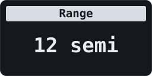 | 1 to 36 semitones | **Range**: how far the notes spread around middle C, half the Range below it and half above. The notes are then snapped to the track's scale and root. 12 is one octave |
| Gate | 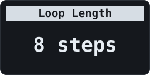 | 1 to 16 steps | **Loop Length**: how many steps the loop has before it repeats |
| Velocity | 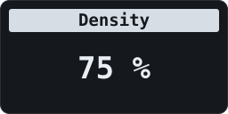 | 0 to 100 % | **Density**: how many of the steps play a note; the rest are rests |
| Time Shift | 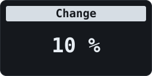 | 0 to 100 % | **Change**: the chance, per step and per pass, that the step gets a new random note. 0 locks the loop |
| Randomness | 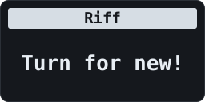 | any turn | **Riff**: throws the loop away and makes a new one |

The first time after power-on, a Flux track starts at 8 steps, Range 12, Density 75 % and Change 10 %: a one-bar
phrase that drifts slowly.

**Scale and Root** (Shift + keyboard, as on a normal track): Flux's notes are snapped to the track's scale and
root, so Minor or Blues with a root of D keeps every note in D minor or D blues.

**Last Step + Step N** sets the loop to N steps. The 16/32/48/64 page buttons do nothing there: a generative loop
is 16 steps at most, and your stored pattern's length is left as it is.

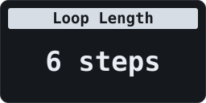

**Press a step** to turn it off (a rest) or on again (it plays its note). The step buttons only ever change the
loop in Flux: holding a step and playing keys does not write into your stored pattern.

On the step LEDs, **magenta** flashes on a step at the moment Change gives it a new note, so you can see the
loop change.

### Pulse (Track 1)


In Pulse, every drum lane spreads a number of pulses as evenly as possible over a number of steps.
A drum lane is one drum sound, one per key of the lower two octaves, as in Drum mode.
4 pulses over 16 steps is four on the floor, 3 over 8 is the tresillo. Give each drum its own count and length and
the lanes drift against each other into grooves that take a long time to repeat.

There are 24 drum lanes, one per key of the lower two octaves. **Press a key to pick its drum lane**, as in Drum
mode; the five encoders then set that lane:

| encoder | screen | range | what it does |
|---|---|---|---|
| Pitch | 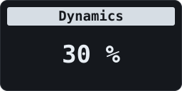 | 0 to 100 % | **Dynamics**: how much the velocity of this lane's hits varies. At 0 % every hit plays at velocity 100; turn it up and each hit gets a random velocity, from about 30 to 127 at 100 % |
| Gate | 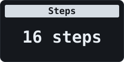 | 1 to 16 | **Steps**: the length of this lane's loop |
| Velocity | 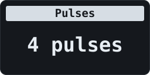 | 0 to Steps | **Pulses**: how many pulses, spread as evenly as possible over the steps. 0 silences the lane |
| Time Shift | 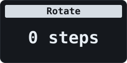 | 0 to Steps minus 1 | **Rotate**: moves the pulses later, so the same rhythm starts on another step |
| Randomness | 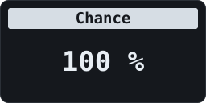 | 0 to 100 % | **Chance**: the chance that each pulse plays: below 100 % the beat starts to breathe |

The first time after power-on, Pulse starts with a plain beat to build on: kick (the first key, note 36) 4 pulses,
snare (note 38) 2 on the backbeat, closed hat (note 42) 8, all over 16 steps.

**Last Step + Step N** sets the picked drum lane's Steps to N. The 16/32/48/64 page buttons do nothing there: a
generative loop is 16 steps at most, and your stored pattern's length is left as it is. A step press on its own
does nothing in Pulse: the hits come from Pulses and Rotate.

### The KeyStep's own settings still work

A generative track listens to the same Shift + keyboard settings as a normal track, including the blue LEDs that
show them while Shift is held:

- **Scale and Root** (Flux): see [Flux](#flux-tracks-2-to-4);
- **Time Division and Triplet**: 1/8 plays half as fast as 1/16, triplets play in threes;
- **Fwd / Rand / Walk**: the loop follows the track's playback direction, as a stored pattern would: it runs
  forward, jumps to random steps, or walks (next step, previous step or the same one).

### What the step LEDs show

The step buttons show the loop itself, not the stored pattern (on Track 1: the picked drum lane):


- **lit steps** are the loop: 9 lit steps is a loop of 9;
- **teal** is a step that plays (a note, or a pulse), **dim** is a rest;
- **white** is the playhead;
- **magenta** (Flux only): a step that just got a new note, see [Flux](#flux-tracks-2-to-4).

### The track display

The track's display shows what the track is doing instead of a pattern number: **FL** for Flux, **PU** for
Pulse. The track display can show FL and PU because the mod also updates the chip that drives the panel.

### Settings kept until power-off

Flux and Pulse settings are kept per track until power-off: leave generative mode and come back, and they are as
you left them. Nothing is saved to the project.

### Keep what you hear: Record

Record works as it always does: **press Record** (while playing, or before Play) and every step the track plays
is written into the pattern it is on as the playhead passes; **press Record again** to stop. Let Flux or Pulse
run, and record once it plays something you like. The track keeps generating while it records, so what ends up
in the pattern is exactly what you heard, changes included. Leave generative mode (Seq, or Drum on Track 1) and
the recording plays on from the same step.

- **Flux** writes each note with its velocity, a rest as an empty step, and sets the pattern's Last Step to the
  loop length.
- **Pulse** writes each drum hit as it plays, at the velocity it played at, with the lane's own length, so lanes
  of different lengths keep drifting against each other in the pattern too.
- A recorded step replaces what that step held. Save the project as usual to keep it.

### Not stored, on purpose

Nothing about generative mode itself is saved. Power the KeyStep off and every track is back to its normal mode,
with its patterns as they were. That is deliberate: a project on the KeyStep is exactly what MIDI Control Center
syncs and copies, and generative mode keeps out of it. If a loop is worth keeping, record it (above).

## Clean pattern switches (the `filter-midicc` mod)


A pattern can send a Program Change with its Bank MSB and LSB when it starts (`Shift + Track > PC Assign`). The
stock firmware sends all three on every pattern switch, even when the new pattern's values are the same as the old
one's. A synth that reloads its sound on every program change (a Roland JV-1010, for one) then plays the first note
after a switch late.

With `filter-midicc` the KeyStep remembers, per MIDI channel, what it last sent since power-on, and a pattern
switch sends nothing when that channel already has those values. Any difference sends all three as before. The
first switch after power-on always sends. Editing PC, MSB or LSB in the menu still sends on every turn of the
encoder, as stock does.

If you change the sound on the synth by hand, a switch to a pattern with the same Program Change will not send it
again. Switch to a pattern with another program, or flash the stock update, to get the old behaviour.

The mod only affects Bank Select and Program Change sent on a pattern switch. Nothing else changes.

Looking for more cool stuff? I also release open source audio VST plugins as [WET VST](https://wetvst.com).

## For developers

You do not need anything below to use the mods: the browser page does everything.

### Building from the command line

Python 3, `pip install keystone-engine`, and for C mods the
[Arm GNU Toolchain](https://developer.arm.com/downloads/-/arm-gnu-toolchain-downloads):

```
python patches/make_patch.py generative filter-midicc   # -> keystep-pro_Firmware_2.5.20+generative+filter-midicc.kspf
```

`make_patch.py` and the web page both refuse any file that is not the exact stock 2.5.20 update, and both give
byte-identical output. The update file holds firmware for both the main chip and the panel chip, for both models
(the standard KeyStep Pro and the Chroma). Every mod is built for both models, and MIDI Control Center flashes the
set that matches your device.

### How a mod is made

A mod is only our own bytes: its source (C or assembly), the firmware addresses it hooks, and the flash and RAM it
uses (`patches/<mod>/patch.json`, `patches/free_space.json`). Arturia's firmware is never stored or distributed
here; `make_patch.py` and the web patcher read it from your own update file and check its SHA-256 before changing
anything. Each mod has a fixed place in flash and RAM, so mods combine, and two mods that overlap or hook the same
instruction are refused. After changing a mod, `python patches/make_patch.py --export` regenerates the web
patcher's copy (`web/patches/`).

- `web/` - the patcher page (`index.html`, `kspatch.js`) and the exported mods (`patches/`).
- `patches/` - `make_patch.py`, the free flash and RAM, and one folder per mod.
- `docs/` - how each mod hooks the firmware: `docs/GENERATIVE.md`, `docs/FILTER_MIDICC.md`.

## Licence

MIT, see `LICENSE`. Arturia and KeyStep Pro are trademarks of Arturia; this project is not affiliated with Arturia.
